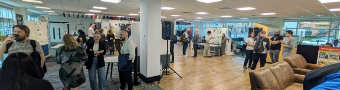
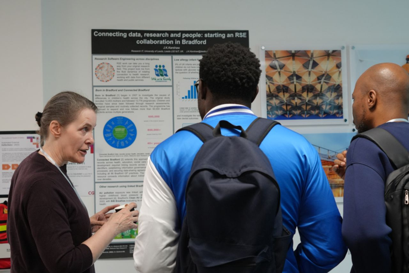
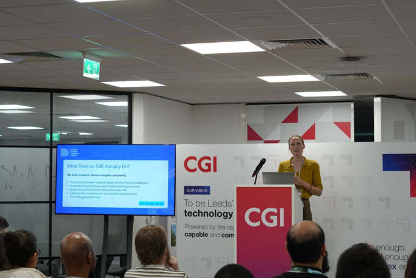
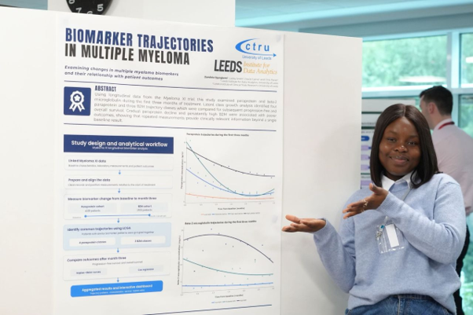
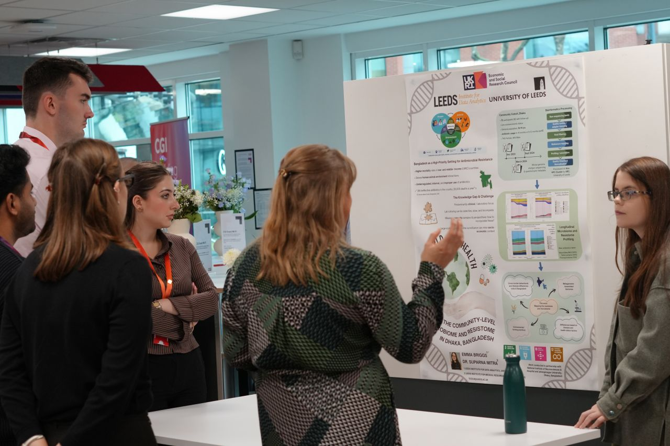
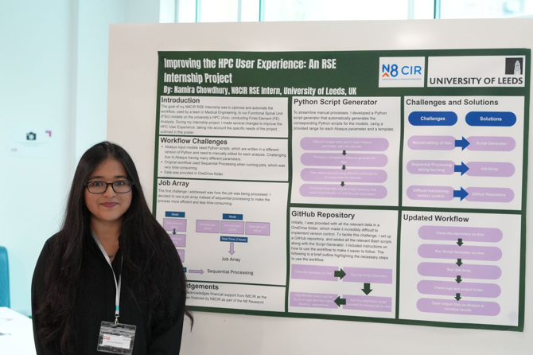

# [Event] Digital Research Futures: Showcasing Talent, Technology and Research Impact

What a turnout and buzz from the sharing of ideas and the building of future Academia \+ Industry collaborations\! This event was a collaboration between N8CIR and University of Leeds ARC team to bring together academics, RSEs and industry professionals. We set out with the aim to raise the profile of digital research technical professionals both within and beyond academia, by showcasing some of the amazing work they do to support research. The event was an opportunity to achieve this aim and find new opportunities for collaboration and knowledge sharing.

The format of the event involved a networking and poster session with coffee, tea and cakes. After an hour of network building we brought everyone together for a series of presentations from representatives of the Leeds RSE, N8, LIDA and industry communities. We followed the presentations with more open networking until the event close.

>Jo Kershaw presenting her poster on "Exploring Infant Tooth Decay and Prescriptions of Low-allergy Infant Formula​" to attendees

## Presentations

The presentations kicked off with a clear narrative of the value of Research Software Engineers (RSEs) and their vibrant professional communities. Sorrel Harriet from Advanced Research Computing (ARC) at Leeds demystified the RSE role, highlighting the unique blend of software engineering discipline, technical agility, and domain knowledge required to support data-intensive academic discovery. Expanding on this human infrastructure, Sam Bland from N8CIR explored the ecosystem of Research Software Communities. Moving from small, localized team setups to expansive regional and national networks, Sam introduced how these communities bring together diverse skills across academic domains and technical disciplines.

>Sorrel Harriet presenting on the topic "What does an RSE do?"

Mark Lambe from CGI introduced us to Trusted Research Environments (TREs), walking attendees through core TRE architecture, compliance standards, and best principles for safeguarding high-risk data. Mark detailed how CGI supports the open-source Azure TRE platform to deliver secure, scalable analytics environments for complex research. Bringing those principles to life, Ifeanyi Chukwu demonstrated how the Leeds Analytics Secure Environment for Research (LASER) is supporting research using sensitive commercial data. Showcasing the Leeds Analytics Secure Environment for Research (LASER/LIDAR).

Richard Hodgett from Leeds University Business School introduced the Leeds MBA & Data Science Development Programmes, bridging the gap between technical capabilities and business application. Richard outlined how these initiatives provide hands-on data engineering support and artificial intelligence capabilities to real world data. They are equipping researchers and industry partners to translate complex analytics into strategic value.

Together, the sessions highlighted a complete ecosystem for contemporary research—showing how skilled personnel, strong communities, secure data environments, and targeted AI programs unite to push the boundaries of modern research.

## Posters

The post-event poster session offered a compelling look into the breadth of impactful work driven by research software engineering (RSE) and data analytics, bridging the gap between complex computational methods and real-world domain insights.

### Health Data and Biomarkers

>Damilola Ogungbemi presenting her poster on the topic "Biomarker Trajectories in Multiple Myeloma"

In healthcare analytics, **Damilola Ogungbemi** demonstrated how longitudinal data can reveal key biomarker trends in multiple myeloma patients, taking attendees through a complete study design and data workflow that culminated in an interactive dashboard. Exploring the micro-level drivers of health, **Emma Briggs** detailed her work with the Institute for Data Analytics on antimicrobial resistance in the gut, highlighting how High-Performance Computing (HPC) powers large-scale biological data processing. Meanwhile, **Jo Kershaw** illustrated the power of population health datasets, showing how combining the Connected Bradford dataset with dedicated RSE input yields vital insights into infant tooth decay and low-allergy formula prescriptions.

### High-Performance Computing and Explainable A

>Emma Briggs​ presenting her poster on the topic "What Can the Gut Tell Us About Antimicrobial Resistance?

The remaining posters showcased the direct impact of RSE expertise on algorithm performance and user accessibility. **Dr. Andrew Harvie** presented a fast astrophysical fluid dynamics code, exemplifying how blending deep academic domain knowledge with software engineering techniques yields highly optimized performance. Tackling computing accessibility, **Namira Chowdhury** shared valuable outcomes from an N8 CIR internship focused on improving the overall HPC user experience. Finally, **Dr. Nouran Khallaf** explored readability evaluation through Explainable AI, comparing LLM and encoder-based approaches while providing a clear breakdown of how each model interprets complex text.

## Next steps

Following the event the organiser team from N8CIR and ARC had a meeting to discuss how the event had gone, anything we can do better next time and what should be next.
 This proved to be an insightful discussion and led to a number of follow up ideas.
 Below is the output of this discussion.

### Did we meet our aims

The intention of the event was to leverage the Leeds Digital Festival to connect the active RSE community in the N8 with the professional software community in Leeds. As this was something we hadn’t tried before, we didn't know what turnout or engagement to expect.
 A lot of effort went into advertising the event and spreading the word in both the RSE and Leeds Digital communities and this paid off with a turnout that exceeded our initial expectations.
 This turnout combined with the ideal venue (CGI in Leeds) created a great atmosphere with maintained attendance and vibrant discussions to the end of the event with some still going on as chairs were packed up and we were moved on.

Early signs of impact are already emerging:

* Growing interest in RSE careers, reflected in a very strong response to recent recruitment activity at the University of Leeds.
* Expanded pool of real-world case studies that are already being used to strengthen how RSE contributions are communicated across the Leeds research community.
* New collaborative opportunities identified through discussions initiated at the event.
* Strong social media engagement following the event.
* The event created valuable opportunities for N8 interns and early-career RSEs to share their work and establish new professional connections

>Namira Chowdhury presenting her poster on the topic "Improving the HPC user experience"

We’ll keep our ears to the ground for signals of longer-term impact from the event.

### What could have gone better

Although we had a great turnout there is always room for improvement in this area.
 A greater range of talks to match the diversity of the poster topics could have improved this aspect although the talks presented showed strong collaboration opportunities between industry and academia.
 We also hoped to extend engagement beyond Leeds to the whole of the N8CIR. As this was the first time we had run this event we didn't push this aspect too much and we discussed alternative options below.
 Although the feedback we got was positive, we had very few responses to our feedback form.

### What is next for collaboration between RSEs in the N8CIR and digital industry?

This event showed the local interest in creating industry/academia links between digital professionals. In future we hope to support the running of similar events across other N8 locations.
It was agreed in our follow up discussions that more outward facing events would be beneficial to the RSE community.
We intend to build on the success of this event by hosting a similar event at next year’s Leeds Digital Festival, where we’d hope to attract more presenters from the N8 community.
There are also opportunities to connect this initiative and other N8CIR initiatives including the N8CIR internships scheme.

## Closing thoughts

This event was prepared using the N8CIR event framework doc. This promoted consistent approaches to identifying aims, planning the event, post event analysis and impact tracking.

If you are interested in running a similar event please contact N8CIR Enquiries [enquiries-n8cir@manchester.ac.uk](mailto:enquiries-n8cir@manchester.ac.uk)
